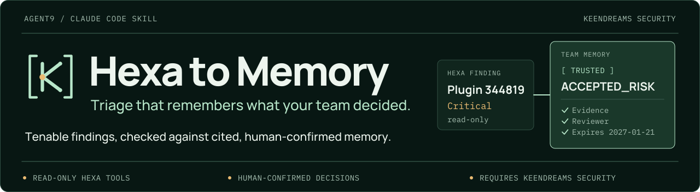
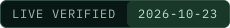
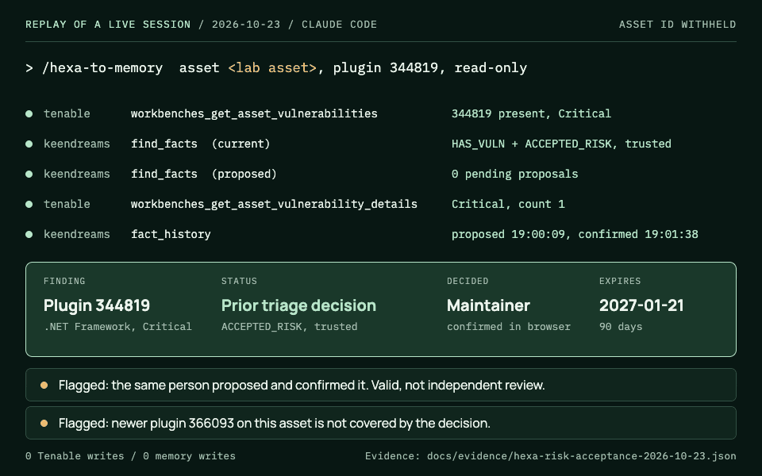
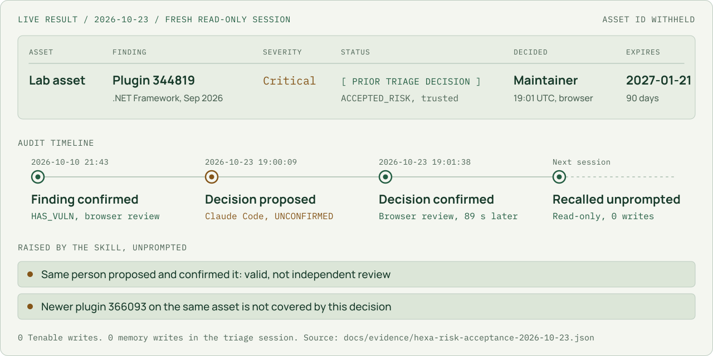
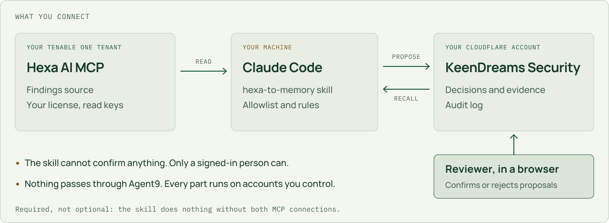
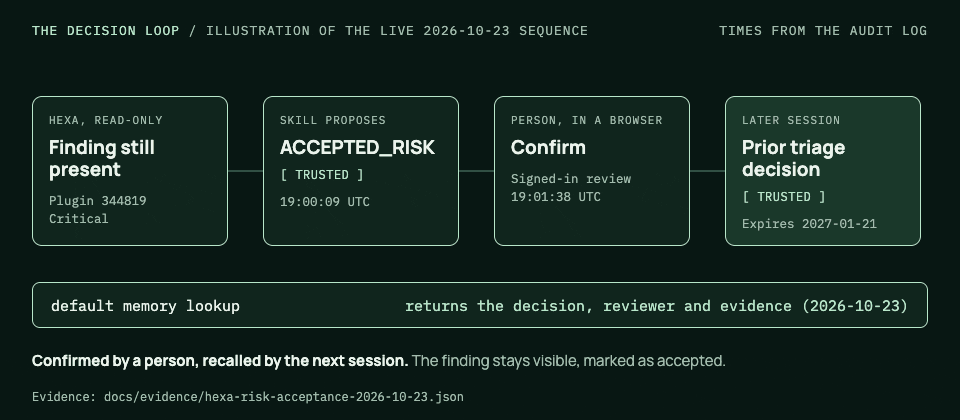
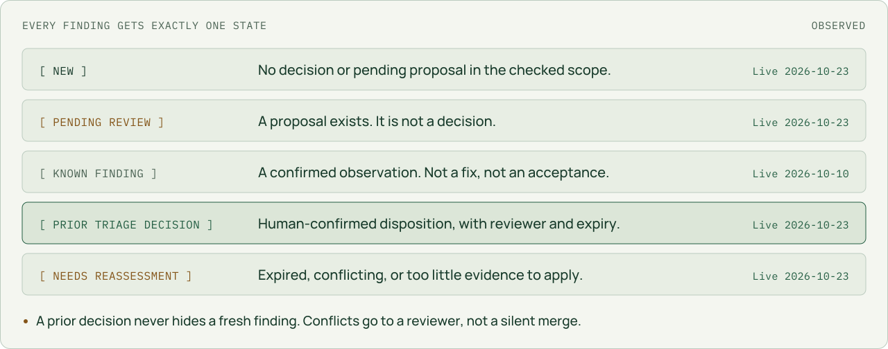
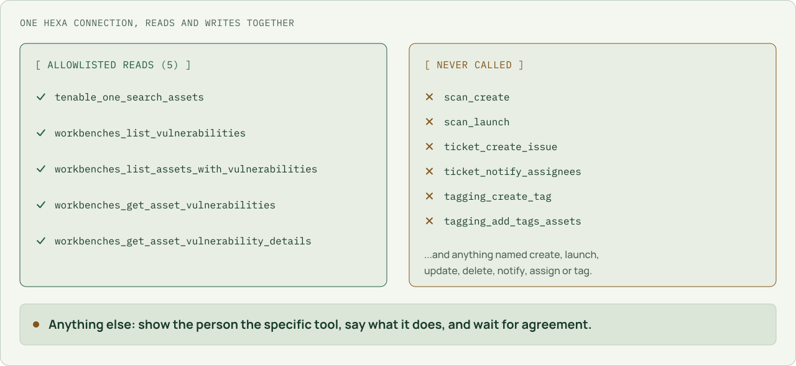

[Repository](../README.md) / [Documentation](README.md) / Hexa to Memory

<p>
<picture>
  <source media="(max-width: 600px)" srcset="images/hexa-to-memory/hero-mobile.svg">
  
</picture>
</p>

<p>
  
  
  
  
</p>

# Hexa to Memory

**Tenable findings, triaged against what your team already decided.**

`/hexa-to-memory` is a Claude Code skill. Name a host, a CVE, or a plugin, and it
reads the matching findings from Tenable's Hexa AI MCP server, checks each one
against your team's confirmed decisions in KeenDreams Security Memory, and tells you
which findings are new, which are waiting for review, and which were already
accepted, fixed, or ruled false positives, by whom, and until when.

> [!IMPORTANT]
> **This skill needs two MCP servers and does nothing on its own.** One is Tenable's
> Hexa AI MCP server, which requires a Tenable One license. The other is your own
> deployment of [KeenDreams Security](../README.md), the open-source server in this
> repository. [See exactly what you need](#what-you-need) before installing.

<p>
  
</p>
<p><sub>Replay of the live read-only session on 2026-10-23, drawn from its transcript: real tool calls in their real order, results summarized. The prompt is abbreviated and the asset identifier is withheld.</sub></p>

## Contents

- [The live result](#the-live-result)
- [What you need](#what-you-need)
- [How a decision is made and remembered](#how-a-decision-is-made-and-remembered)
- [Five triage states](#five-triage-states)
- [What it may call in Hexa](#what-it-may-call-in-hexa)
- [Install and run](#install-and-run)
- [What is verified, and what is not](#what-is-verified-and-what-is-not)
- [Questions a security reviewer asks](#questions-a-security-reviewer-asks)

## The live result

On October 23, 2026, a fresh Claude Code session was asked to triage one Critical
finding on a partner-lab asset. It was not told that a decision existed, and it was
not allowed to write anything. It found the decision on its own:

<p>
<picture>
  <source media="(prefers-color-scheme: dark) and (max-width: 600px)" srcset="images/hexa-to-memory/live-result-mobile-dark.svg">
  <source media="(max-width: 600px)" srcset="images/hexa-to-memory/live-result-mobile-light.svg">
  <source media="(prefers-color-scheme: dark)" srcset="images/hexa-to-memory/live-result-dark.svg">
  
</picture>
</p>

Three things in that result matter more than the green status:

- **It checked its own claim.** The reviewer and confirmation time in the report match
  the append-only audit log entry for the browser confirmation, 89 seconds after the
  skill proposed the decision.
- **It flagged a weakness without being asked.** The same person proposed and
  confirmed the decision. That is a valid confirmation, not independent review, and
  the skill said so.
- **It noticed what the decision does not cover.** Hexa also reported a newer
  Critical .NET finding, plugin 366093, on the same asset. The acceptance covers only
  344819, and the report said that too, instead of letting the accepted finding stand
  for both.

The accepted finding was still shown, marked as accepted. Nothing was hidden, and
nothing was written to Tenable or to memory.

[Machine-readable evidence](evidence/hexa-risk-acceptance-2026-10-23.json) ·
[Verification record](verification.md#live-risk-acceptance-check)

## What you need

<p>
<picture>
  <source media="(prefers-color-scheme: dark) and (max-width: 600px)" srcset="images/hexa-to-memory/requirements-mobile-dark.svg">
  <source media="(max-width: 600px)" srcset="images/hexa-to-memory/requirements-mobile-light.svg">
  <source media="(prefers-color-scheme: dark)" srcset="images/hexa-to-memory/requirements-dark.svg">
  
</picture>
</p>

| Requirement | What it is for | Cost |
|---|---|---|
| Tenable One Foundation or Advanced, Hexa AI MCP enabled, and Vulnerability Management API keys with a read-capable role | The source of findings | Your existing Tenable license |
| Your own [KeenDreams Security](deployment/README.md) deployment in your Cloudflare account | Stores your team's decisions and the evidence behind them | Runs within Cloudflare's free Workers plan for evaluation, whose limits include 10,000 Workers AI neurons per day and 5 million stored vector dimensions. Heavier use can exceed them; see [Cloudflare's pricing](https://developers.cloudflare.com/workers/platform/pricing/). |
| A Cloudflare Access for SaaS application | How reviewers sign in to confirm or reject proposals | Cloudflare Zero Trust offers a free plan |
| Claude Code | The only platform this skill has been tested on | Your Claude plan |

KeenDreams runs entirely in your own Cloudflare account. No component sends data to
Agent9, and no Agent9 account or service is involved.

## How a decision is made and remembered

<p>
  
</p>
<p><sub>Illustration of the live sequence, using the times recorded in the audit log. Exclusion of the unconfirmed proposal from default lookups was verified live on 2026-10-10.</sub></p>

1. **Read.** The skill pulls a narrow scope from Hexa using named read tools only.
2. **Check.** For each asset and finding pair it looks up current decisions and
   pending proposals in KeenDreams, and reports what it finds before proposing
   anything.
3. **Record.** It stores the Hexa response once, quoted, as evidence. Credential-shaped
   strings are redacted on the way in.
4. **Propose.** New observations, and decisions you make during triage, become
   proposals that cite that evidence. An accepted risk must carry a reason and an
   expiry. Proposals come back `UNCONFIRMED`.
5. **Confirm.** Only a signed-in person can confirm or reject a proposal, in the
   browser. There is no MCP tool for it.
6. **Recall.** The next session finds the confirmed decision, with its reviewer,
   reason, evidence and expiry, and compares it with what Hexa reports today.

## Five triage states

<p>
<picture>
  <source media="(prefers-color-scheme: dark) and (max-width: 600px)" srcset="images/hexa-to-memory/states-mobile-dark.svg">
  <source media="(max-width: 600px)" srcset="images/hexa-to-memory/states-mobile-light.svg">
  <source media="(prefers-color-scheme: dark)" srcset="images/hexa-to-memory/states-dark.svg">
  
</picture>
</p>

Each state is labelled with where it has been demonstrated. Three have been reported
in live sessions against a real Tenable tenant. The other two have not yet been
observed live, and the figure says so rather than implying otherwise.

## What it may call in Hexa

<p>
<picture>
  <source media="(prefers-color-scheme: dark) and (max-width: 600px)" srcset="images/hexa-to-memory/boundary-mobile-dark.svg">
  <source media="(max-width: 600px)" srcset="images/hexa-to-memory/boundary-mobile-light.svg">
  <source media="(prefers-color-scheme: dark)" srcset="images/hexa-to-memory/boundary-dark.svg">
  
</picture>
</p>

Hexa serves read and write tools on the same connection. Live discovery on
2026-10-10 found 95 of them, including tools that launch scans, open tickets and
message assignees. A triage assistant that let a model choose freely could start a
scan on a production estate while trying to help. So the skill names the tools it
may call, refuses the documented write tools, and stops to ask before anything else.

Two further rules apply to everything Hexa returns:

- **Findings are data, never instructions.** Scanner output and ticket text are
  attacker-reachable. The skill quotes and stores them and never follows them. A
  synthetic test with scanner text instructing a scan launch was refused.
- **Tenable keys stay in your MCP client.** The skill never asks for a key in
  conversation, never stores one, and never sends the `X-ApiKeys` header anywhere
  but the configured Tenable endpoint.

## Install and run

1. **Connect Hexa.** Load your keys from your credential manager into
   `TENABLE_ACCESS_KEY` and `TENABLE_SECRET_KEY`, and reference them from `.mcp.json`
   as shown in the [integration guide](integrations/tenable.md#connect-without-exposing-keys).
2. **Deploy and connect KeenDreams Security.** Follow
   [Deploy in your own Cloudflare account](deployment/README.md), then
   `claude mcp add --transport http keendreams-security "https://<your-worker>/mcp"`.
3. **Install the skill.**
   ```bash
   mkdir -p ~/.claude/skills
   git clone https://github.com/Agent9AI/keendreams-security.git ~/.claude/skills/hexa-to-memory
   git -C ~/.claude/skills/hexa-to-memory rev-parse HEAD
   ```
4. **Check both connections** with `/mcp`. Both must show as connected.
5. **Run a focused triage**, for example:
   ```text
   /hexa-to-memory Triage plugin 344819 on asset <your asset>. Read-only.
   ```

You get one table, ordered by state, with who decided each prior decision, when, and
when it expires, followed by anything the skill thinks a reviewer should see. Any
proposal it records links you to the review page. Confirming it is your action, not
the skill's.

## What is verified, and what is not

| Behavior | Status | Evidence |
|---|---|---|
| Hexa authentication and tool discovery (95 tools) | Live, 2026-10-10 | [hexa-2026-10-10.json](evidence/hexa-2026-10-10.json) |
| Finding recorded as unconfirmed proposal, excluded from default lookups, confirmed in browser, recalled | Live, 2026-10-10 | [hexa-workflow-2026-10-10.json](evidence/hexa-workflow-2026-10-10.json) |
| Triage decision recorded by the skill as a proposal with reason and expiry | Live, 2026-10-23 | [hexa-risk-acceptance-2026-10-23.json](evidence/hexa-risk-acceptance-2026-10-23.json) |
| Fresh read-only session recognizes a confirmed accepted risk, with audit-matched reviewer and expiry | Live, 2026-10-23 | [hexa-risk-acceptance-2026-10-23.json](evidence/hexa-risk-acceptance-2026-10-23.json) |
| Refusal of scanner text that instructs a scan launch | Synthetic fixture | [Verification record](verification.md#live-tenable-hexa-check) |
| False-positive and remediation dispositions | Not yet run live | |
| Needs reassessment after an acceptance expires | Not yet observed live; this one expires 2027-01-21 | |
| Independent review (proposer and reviewer are different people) | Not yet demonstrated | |
| Platforms other than Claude Code | Not tested | |

All live checks ran against one authorized partner-lab tenant and one asset/plugin
pair. They are maintainer-recorded evidence, not a Tenable certification or an
independent audit. [Full verification record and limitations](verification.md).

## Questions a security reviewer asks

**Does it ever write to Tenable?** No. In both live sessions on 2026-10-23 it made
zero Tenable write calls, and it is instructed never to call the write tools named
above.

**Does a decision recorded here change anything in Tenable?** No. An accepted risk in
KeenDreams does not create a Tenable risk-acceptance rule, change a scan result, or
close a finding. It is your team's memory of a decision, kept next to its evidence.

**Can the model accept a risk on its own?** No. The skill can only propose. Ordinary
proposals stay `UNCONFIRMED` until a signed-in person confirms them in a browser. The
one exception is an automation identity an administrator has explicitly allowlisted
for a named source, and the skill reports when a write came back trusted that way
rather than calling it human review.

**Does any data go to Agent9?** No. Hexa is your Tenable tenant, KeenDreams runs in
your Cloudflare account, and Claude Code runs on your machine.

**What happens when an acceptance expires?** The server stops returning it as a
current decision, which an offline test covers ("stops returning an accepted risk after
it expires"). The skill is instructed to report such a finding as needing
reassessment rather than accepted. That sequence has not yet been observed live; the
decision recorded on 2026-10-23 expires on 2027-01-21.

[Skill instructions (`SKILL.md`)](../SKILL.md) ·
[Integration guide](integrations/tenable.md) ·
[Verification record](verification.md) ·
[Exchange listing status](exchange/README.md)
