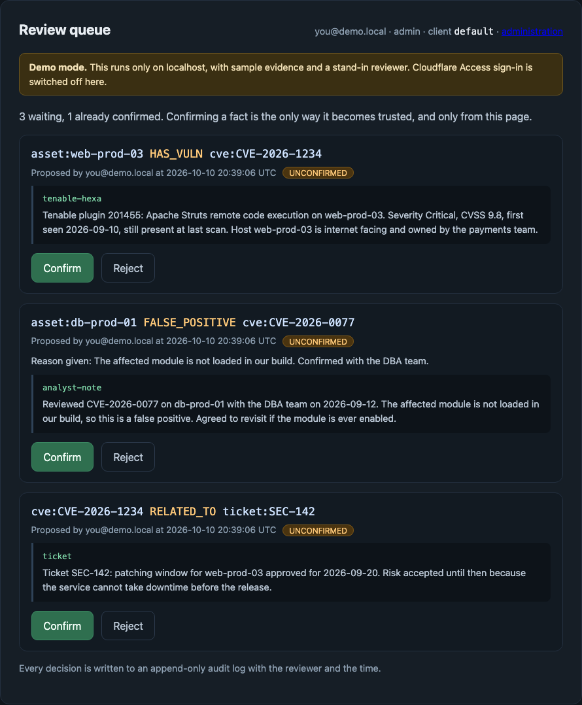
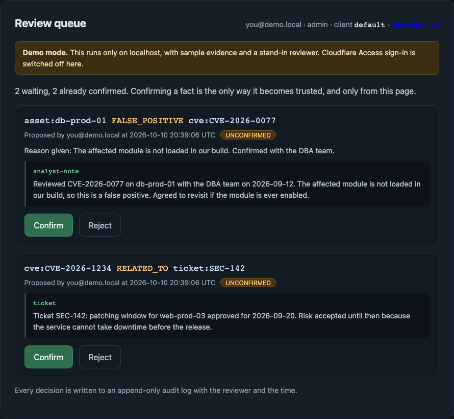
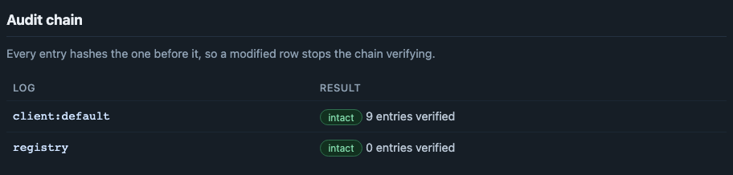

[Repository](../README.md) / [Documentation](README.md) / Start here

# Your first evidence-backed decision

Start with the local demo to understand the product. Then choose whether to
connect your own application, an agent, or the optional Tenable workflow.

## 1. See the review workflow without any accounts

You need Git, Node.js 22 or later, and network access to install dependencies.
You do not need a Cloudflare or Tenable account for this local demonstration.

```bash
git clone https://github.com/Agent9AI/keendreams-security
cd keendreams-security/worker
npm ci
npm run demo
```

Keep that terminal running. Open `http://localhost:8787/review` on the same
computer when the terminal reports that the server is ready. If it selects a
different port, use that port instead. Local addresses are explained in the
[demo guide](local-demo.md).

On a fresh demo, locate the proposal for `asset:web-prod-03`. The page shows the
relationship, quoted evidence, and its unconfirmed status. This is synthetic
sample data; the displayed CVE and source label are not a live Tenable finding.

| Action | What to observe |
|---|---|
| Read the proposal | Evidence is visible before a decision is made. |
| Click Confirm once | The proposal leaves the pending queue; confirmation does not mean the vulnerability is fixed. |
| Open `http://localhost:8787/admin` | The client audit chain reports intact and includes the review action in its verified history. |

The demo uses a stand-in reviewer restricted to loopback. Remote AI and vector
health checks are labelled live only. This quickstart demonstrates browser review
and the audit check, not live semantic search or the Hexa integration.
Press Ctrl+C to stop the local server.

<details>
<summary>See the recorded first-run result</summary>

These screenshots were captured from the running application on 2026-10-10.
An automated browser clicked the real Confirm control once using the local
demo reviewer. They contain synthetic fixtures, not customer or live Tenable data.

**Before:** three proposals were waiting and one fact was already confirmed.



**After one confirmation:** two proposals remained and two facts were confirmed.



**Audit:** the client chain stayed intact and increased from eight to nine entries.



[Machine-readable browser-check result](evidence/local-first-decision-2026-10-10.json).

</details>

## 2. Give an application or agent its own memory

For a real deployment, follow the [deployment guide](deployment/README.md).
Configure Cloudflare resources and Access for SaaS, then connect the deployed
`/mcp` endpoint in your client. Each application needs an integration that invokes
the tools; simply deploying the server does not copy its existing history.

A useful first workflow is:

1. Use `find_facts` to check the chosen asset and relationship.
2. Use `record_episode` to preserve authorized evidence.
3. Use `assert_fact` to propose an evidence-linked relationship.
4. Verify the proposal is absent from default trusted recall.
5. Review it through the returned browser link.
6. Query again from a later session and inspect the evidence and history.

Use a deployment without an automation trust allowlist for this manual-review
exercise. [Tool arguments and outputs](reference/mcp-tools.md) ·
[Worked examples](walkthrough.md).

## 3. Add Tenable when you have eligible access

The core memory service needs no Tenable license. Hexa adds access to your
authorized Tenable data; its own licensing, enablement, and API permissions apply.
Use the [secure Hexa setup](integrations/tenable.md#connect-without-exposing-keys),
then evaluate one scoped finding with the documented acceptance checks.

Live authentication, tool discovery, and one bounded read have passed. The full
finding-to-memory workflow remains pending. Check the
[verification record](verification.md#live-tenable-hexa-check) before interpreting
any example as verified interoperability.

## If something does not work

| Symptom | Next check |
|---|---|
| The local page will not open | Confirm the demo terminal is still running, use its reported port, and open the address on the same computer. |
| The demo proposal is no longer pending | A previous local review may already have processed it. Local state can persist across restarts. |
| A deployed server shows a setup page | Check the named missing settings in your own deployment; do not send their secret values in a support request. |
| MCP says authentication is required | Complete the client's OAuth login and verify it reports connected before calling tools. |
| Hexa connects but a data query is denied | Check that the API-key owner can read that scope; do not widen permissions indiscriminately. |

[Community help, private security reporting, and optional paid assistance](../.github/SUPPORT.md).
